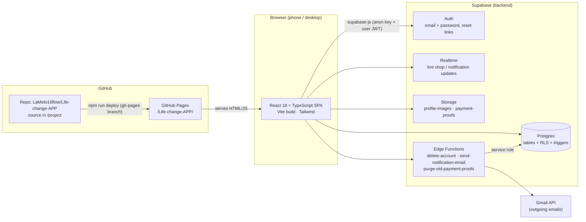
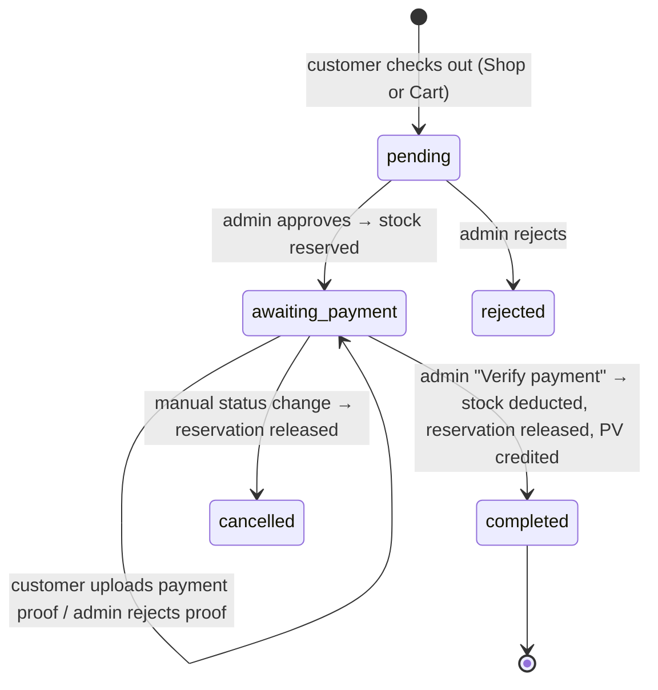

# Life Changers app — architecture

Live site: https://lamelo16flow.github.io/Life-change-APP/

## 1. Big picture



There is no custom server: the browser talks directly to Supabase. **Security
therefore lives in the database** (Row Level Security policies, triggers and
`SECURITY DEFINER` functions), not in the React code — anything the UI hides
must also be blocked in Postgres.

## 2. Front-end (`project/src`)

```
main.tsx → App.tsx
  LanguageProvider   (FR / EN strings — contexts/LanguageContext.tsx)
  ToastProvider      (pop-up messages)
  AuthProvider       (session, profile, role, permissions, password reset)
    ├─ ResetPasswordForm   if the user arrived from a reset-password email
    ├─ AuthForm            if logged out / not approved (login, sign-up, forgot password)
    └─ Dashboard           if logged in and approved
         ├─ User view:  Shop · Cart · MyOrders · PVHistory · Notifications · UserProfile
         └─ Admin view: AdminOverview · ManagerManagement (master only) · UserManagement
                        AccountApprovals · ProductManagement · InventoryManagement
                        OrderManagement · ProductAnalytics · ProductPromotions
                        PromotionApprovals · PaymentSettings · Notifications
```

| Folder | Role |
|---|---|
| `lib/supabase.ts` | Supabase client, shared types, `SITE_URL`, reads reset-link parameters before the client consumes them |
| `contexts/` | Auth, language, toasts (global state) |
| `components/user/` | Customer screens |
| `components/admin/` | Admin / manager screens |
| `utils/` | Notifications + emails, currency, PV rounding, rate limiting, localisation helpers |

## 3. Roles

| Role | How it is set | Can do |
|---|---|---|
| **Super admin** (`is_master = true`) — wilfriednawoussi4@gmail.com | migration | Everything, incl. the Team tab (managers). **Cannot be demoted, deactivated or deleted** by anyone (DB trigger `a_protect_master_profile_update/delete`). Only he can grant super-admin. |
| Admin (`role = 'admin'`) | promoted by an admin | Every admin tab except Team |
| Manager (`role = 'manager'`) | Team tab | Only the tabs matching rows in `manager_permissions` (`manage_orders`, `manage_inventory`, `manage_users`, `manage_accounts`, `manage_products`, `manage_promotions`) |
| User | sign-up + approval | Shop, cart, own orders, own PV, profile |

## 4. Main data (Postgres)

`profiles` (1 per auth user: role, is_master, account_status, total_pv, address) ·
`products` · `product_prices` · `product_inventory` (quantity, reserved_quantity per region) ·
`inventory_logs` · `cart_items` · `orders` · `order_items` · `pv_transactions` ·
`product_promotions` · `notifications` · `admin_settings` · `country_payment_info` ·
`countries` · `manager_permissions`.

## 5. Key flows

**Sign-up → approval.** Sign-up creates the auth user + profile (`pending`), signs
out and emails staff. An admin approves in *Accounts*; only `approved` users get
past the login screen.

**Order lifecycle.**



Approve and Verify first *claim* the order with a conditional update
(`WHERE status = 'pending'` / `'awaiting_payment'`), so double clicks or two
admins at once can never reserve stock twice or credit PV twice. A completed
order is final in the manual status menu, and "completed" can only be reached
through Verify payment.

**Forgot password.** `AuthForm` → `resetPasswordForEmail(email, redirectTo = SITE_URL)`
→ Supabase emails a link → the link opens the live site with `#type=recovery` →
`ResetPasswordForm` (stays there even after a reload) → new password saved → the
user is signed out and logs in with the new password. Expired/used links show a
message and reopen the "forgot password" form.

## 6. Deployment

* `cd project && npm run deploy` builds with the local `.env`
  (`VITE_SUPABASE_URL`, `VITE_SUPABASE_ANON_KEY`) and pushes `dist/` to the
  `gh-pages` branch, which GitHub Pages serves. **This is what is live today.**
* `.github/workflows/deploy.yml` (deploy on push to `main`) is fixed but only
  works if Settings → Pages → Source is set to **GitHub Actions** and the two
  `VITE_SUPABASE_*` values are added as repository secrets.
* Database changes live in `project/supabase/migrations/` and must be run in
  the Supabase SQL editor (or `supabase db push`).

## 7. Supabase settings the app depends on

* Authentication → URL Configuration → **Site URL** =
  `https://lamelo16flow.github.io/Life-change-APP/`
* **Redirect URLs** must include `https://lamelo16flow.github.io/Life-change-APP/**`
  (otherwise Supabase ignores the reset link's redirect and falls back to the Site URL).
* Email template "Reset password" should use `{{ .ConfirmationURL }}`.
